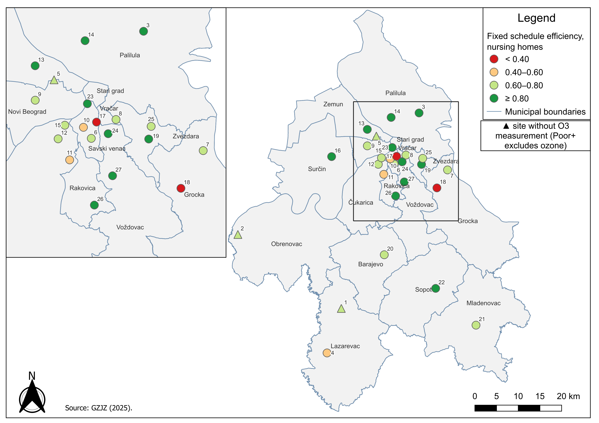

# From Data to Decisions: Decision Rules for Planning Outdoor Activities in Sensitive Facilities Based on Hourly Air Quality Data in Belgrade, Serbia (2024–2025)

This repository presents an interactive web application and the analytical framework of a research study on simple decision rules that schools, kindergartens and nursing homes can use to plan outdoor activities in Belgrade, Serbia.

The study uses validated hourly measurements from 27 automatic monitoring stations (AMS) of the local air quality monitoring network of the Belgrade City Institute of Public Health (GZJZ), classified according to the revised European Air Quality Index (EAQI). Each rule was derived from one year of data and tested on the other year, in both directions.

The framework moves from describing when adverse hours occur to the practical question a facility faces every morning: when to go outside, without knowing how the day will develop.

**Interactive application "When to go outside?" (Serbian | English):** https://jelena383.github.io/belgrade-from-data-to-decisions/

The application and the protocol are the author's proposals derived from the study; they are not official tools or recommendations of the Belgrade City Institute of Public Health. The application is based on historical data (2024–2025) and does not show current conditions. For current air quality in Serbia, see the portal of the Serbian Environmental Protection Agency: https://vazduh.sepa.gov.rs/

## Project Objective

The study assesses how much simple decision rules, which a facility can apply every morning, reduce the probability that a 2-hour outdoor activity block includes at least one Poor+ hour.

The analysis aimed to answer:

- how much of the possible reduction a fixed seasonal schedule derived from one year achieves when applied to the next year,
- whether a morning check of air quality or data from the previous day bring additional improvement,
- whether a schedule tailored to an individual monitoring site outperforms a single network schedule,
- and how sensitive the results are to the derivation year, the outcome definition, the assumed current slot, the hour of the morning check and the monitoring site.

## Study Area and Data

The analysis covers the territory of the City of Belgrade for the period 1 January 2024 – 31 December 2025.

The dataset comprises 473,634 hourly records from 27 automatic monitoring stations of the GZJZ local network, of which 471,642 hours received a valid EAQI category (15.11% Poor+). The main analysis covers the 24 sites with O3 measurements; the three sites without O3 are shown separately.

## Methodological Framework

### EAQI classification and Poor+ hours

Each hour at each monitoring site was classified according to the revised European Air Quality Index of the European Environment Agency (González Ortiz et al., 2025). Hours classified as Poor, Very poor or Extremely poor were grouped into an operational category **Poor+**. Poor+ is an analytical group defined for the study, not an official index category, and not a boundary between safe and harmful air.

The EAQI classification, the Poor+ category and the data quality control are described in detail in the earlier study on the same dataset: [belgrade-hourly-air-quality](https://github.com/Jelena383/belgrade-hourly-air-quality).

### Outcome

The outcome is the probability that a 2-hour outdoor activity block includes at least one Poor+ hour, for primary schools (two shifts and one shift), kindergartens and outdoor time in nursing homes, by season (winter: December–February; summer: June–August; transitional period: other months).

### Reference strategies

- **Status quo:** the activity every day in an assumed current slot.
- **Ideal choice:** the slot with the fewest Poor+ hours that day, known only in hindsight (upper bound).
- **Random choice:** the expected outcome when the slot is chosen at random.

### Decision rules

1. **Fixed seasonal schedule:** the slot with the lowest probability of a Poor+ block for each facility type and season, at network level.
2. **Morning check:** the slot is chosen according to the EAQI category at 06–07 h at the nearest monitoring site (good, moderate or Poor+), available at about 07 h.
3. **Previous-day rule:** the slot that had the fewest Poor+ hours on the previous day at the same site.
4. **Site-specific schedule:** as rule 1, but derived separately for each monitoring site and season.

### Derivation and testing on separate years

All rules were derived exclusively from 2024 data and tested exclusively on 2025 data, and the whole procedure was repeated in the reverse direction (derived from 2025, tested on 2024).

### Rule efficiency

**Efficiency** is the share of the difference between the status quo and the ideal choice that a rule achieves:

- 1 → the rule achieves the ideal choice,
- 0 → the rule is no better than the status quo,
- negative values → the rule is worse than the status quo.

Confidence intervals were obtained by a month-stratified block bootstrap (weekly blocks, 1,000 replicates).

## Key Findings

- **A simple seasonal schedule carries most of the benefit.** At 24 sites with O3 measurements, the fixed seasonal schedule achieved an efficiency of 0.72 (95% CI 0.66–0.78) for nursing homes, 0.57 (0.46–0.67) for two-shift schools, 0.40 (0.31–0.50) for kindergartens and 0.20 (−0.02–0.40) for single-shift schools.
- **The schedule transfers reliably between years.** In the reverse test, the efficiencies were 0.76, 0.54, 0.45 and 0.10.
- **A large absolute reduction in nursing homes.** The probability of a Poor+ block during outdoor time in nursing homes fell from 23.1% to 9.1%.
- **More complex rules are not robust.** The morning check was reliably better than the fixed schedule in only one test direction (+0.05 to +0.06), the site-specific schedule was reliably but only slightly better in the main test for nursing homes and single-shift schools (+0.03 and +0.09), but not in the reverse test, and the previous-day rule was not reliably better in either direction.
- **The same conclusion for a second outcome.** Results were nearly identical for the number of Poor+ hours per block.

## Proposed Protocol

| Step | School | Kindergarten | Nursing home |
|---|---|---|---|
| 1. Basic slot, winter (December–February) | midday (12–15 h) | 11–13 h | 12–14 h |
| 1. Basic slot, transitional period | 10–12 h | 10–12 h | 10–12 h |
| 1. Basic slot, summer (June–August) | 08–10 h | 08–10 h | 08–10 h |
| 2. Morning check (at 07 h, category for 06–07 h), transitional period only | good: 08–10 h; moderate: 10–12 h; Poor+: 12–15 h | good: 08–10 h; moderate: 10–12 h; Poor+: 11–13 h | good: 08–10 h; moderate: 10–12 h; Poor+: 12–14 h |
| 3. Poor or worse in the chosen slot | reduce intensity and duration or move the activity indoors | same | same |

Slots were derived from 2024 data and tested on 2025 data. The protocol is a starting point for application and further testing, not a final rule. The aim is to reschedule outdoor activity, not to cancel it.

## Interactive Application

The bilingual web application "When to go outside?" (Serbian and English, switch in the top right corner) has four tabs:

- **Plan an activity:** the recommended slot according to the protocol for a selected date, monitoring site and facility type, the historical probability of an adverse 2-hour block for each slot, a map of monitoring sites and a calendar of patterns by month,
- **How the rules performed in 2024–2025:** rule efficiency, testing in both directions, results by season and by monitoring site,
- **Protocol for facilities:** the protocol in a printable form,
- **Explanations:** EAQI, Poor+, rule efficiency, limitations and citation.

The recommendation and the protocol can be printed or saved as PDF.

## Selected Figures

| Rule efficiency in the test year (2025) | Fixed schedule efficiency for nursing homes |
|---|---|
|  |  |

Both figures of the study are available in English in [`figures/en`](figures/en) and in Serbian in [`figures/sr`](figures/sr). Maps were produced in QGIS; source of data: Belgrade City Institute of Public Health (GZJZ, 2025).

## Software and Methods

**Data processing and statistics**

- Python 3.13 (pandas, NumPy, matplotlib)
- Out-of-sample testing on separate years, in both directions
- Month-stratified block bootstrap
- Efficiency relative to reference and ideal decisions

**GIS and spatial analysis**

- QGIS
- GeoPandas
- Environmental cartography

**Web application**

- HTML, CSS and JavaScript
- Leaflet 1.9.4

## Repository Contents

| File | Description |
|---|---|
| `index.html` | Interactive application (Serbian and English) |
| `app.js` | Recommendation, map and calendar |
| `podaci.js` | Monitoring sites, rule tables and historical probabilities |
| `rezultati.js` | Results of the study (tab "How the rules performed in 2024–2025") |
| `protokol.js` | Protocol for facilities |
| `objasnjenja.js` | Explanations, limitations and citation |
| `opstine.js`, `reke.js` | Base map (municipal boundaries and rivers) |
| `stil.css` | Application style |
| `figures/en/` | Both figures of the study (English) |
| `figures/sr/` | Both figures of the study (Serbian) |

Hourly air quality data and the analysis code are not included in the repository. The code is available from the author upon reasonable request.

## Limitations

- Current activity slots of facilities are not known, so the status quo is an assumption; it does not change the direction or order of the results, but it changes their size.
- Only two years of data were available; testing in both directions partly captures year-to-year variability, but does not replace testing on a longer series.
- Validated data were used, whereas a facility would use unvalidated real-time data, so the morning check is an upper bound of its benefit.
- The indicators refer to outdoor air at the monitoring site, not to indoor or personal exposure or dose.
- Summer results for schools are based on about 10 teaching days per year.
- Air quality forecasts were not tested, and O3 is not measured at three monitoring sites.

## Data

Hourly air quality data are the property of the Belgrade City Institute of Public Health and are used with its consent.

## Scientific and Practical Relevance

The study shows how hourly data that a monitoring network already routinely collects can, without new measurements, be translated into:

- a simple seasonal schedule for outdoor activities that transfers reliably from one year to the next,
- a proposed protocol that public health services could recommend to schools, kindergartens and nursing homes,
- and a reproducible test that can be repeated every year, with each new year as a new test.

Such a schedule is a potentially low-cost organisational measure, but it does not replace emission reductions.

## Use of AI Tools

An AI assistant (Claude, Anthropic) was used to assist with writing the code.

## Contact

For additional methodological details, collaboration opportunities, or air quality and GIS-related research inquiries, feel free to connect with me on LinkedIn.

[LinkedIn Profile](https://www.linkedin.com/)

## Author

**Jelena Lukić**
Environmental Monitoring Specialist | GIS & Spatial Analytics
Belgrade City Institute of Public Health
ORCID: [0009-0008-7883-6402](https://orcid.org/0009-0008-7883-6402)
