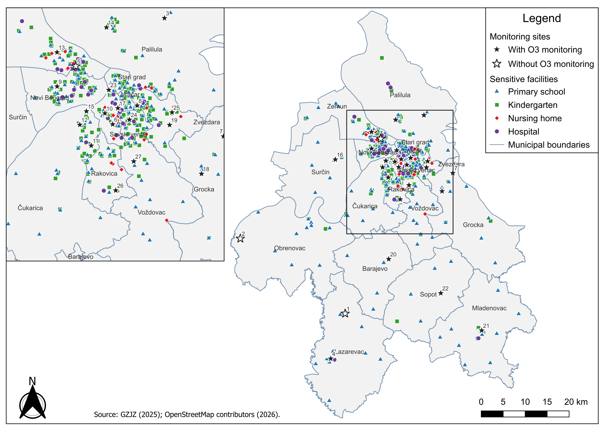
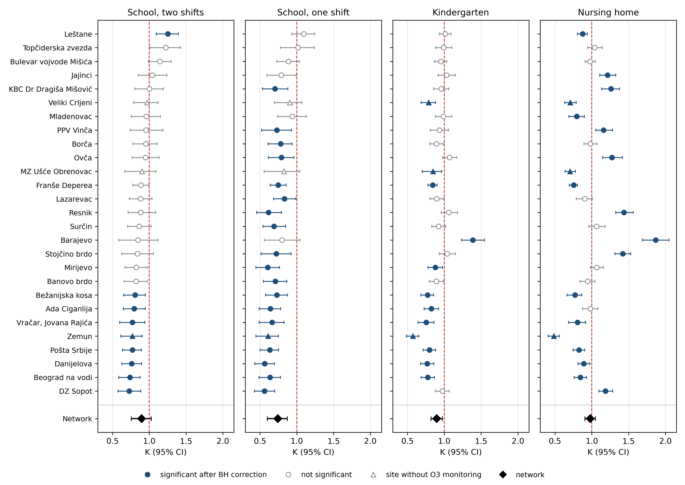
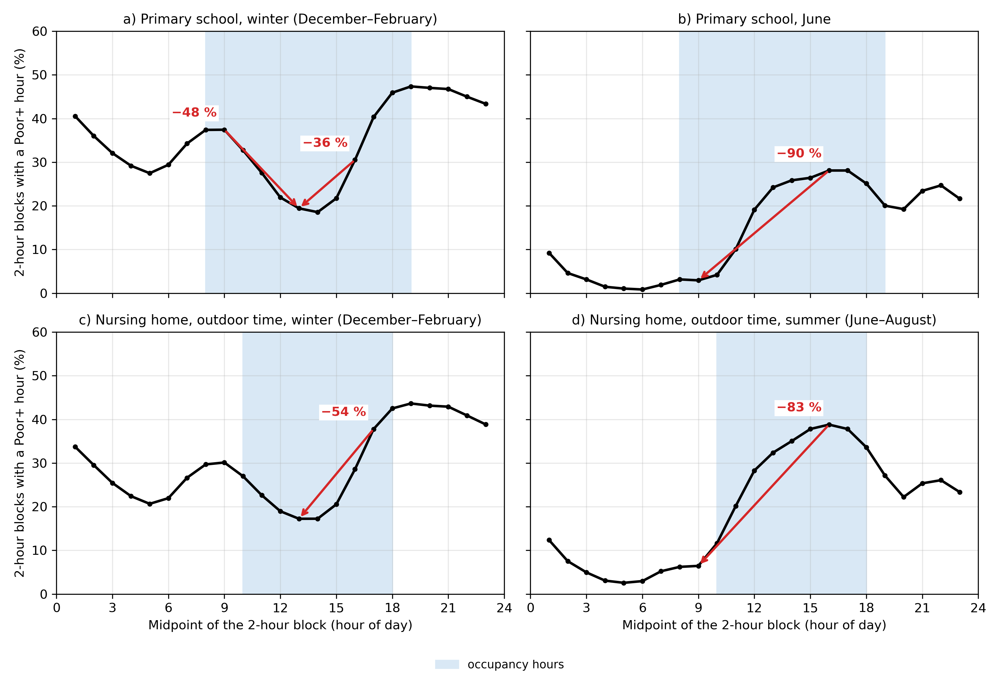
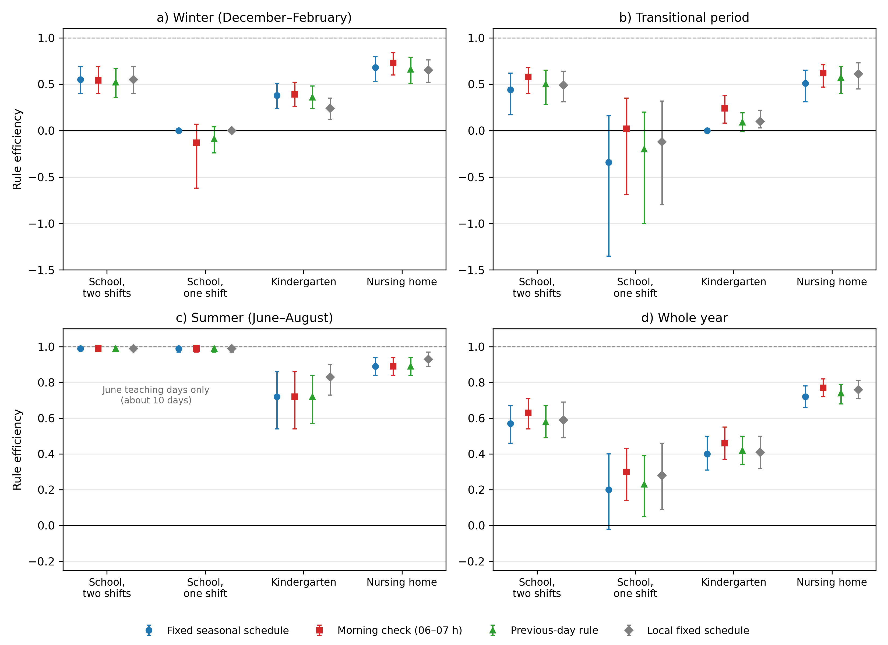

# Timing Matters: From Temporal Alignment of Adverse Air Quality with Occupancy of Sensitive Facilities to Decision Rules for Outdoor Activities in Belgrade, Serbia (2024–2025)

This repository presents an interactive web application and the analytical framework of a research study on when adverse air quality hours in Belgrade, Serbia, coincide with the presence of children and older adults in schools, kindergartens, nursing homes and hospitals, and on simple decision rules that facilities can use to plan outdoor activities.

The study uses validated hourly measurements from 27 automatic monitoring stations (AMS) of the local air quality monitoring network of the Belgrade City Institute of Public Health (GZJZ), classified according to the revised European Air Quality Index (EAQI), and links them with the occupancy hours of 526 sensitive facilities from OpenStreetMap.

The framework has two parts. The first describes the temporal alignment of adverse hours with occupancy hours. The second translates this pattern into decisions: each rule was derived from one year of data and tested on the other year, in both directions.

**Interactive application "When to go outside?" (Serbian | English):** https://jelena383.github.io/belgrade-from-data-to-decisions/

The application and the protocol are the author's proposals derived from the study; they are not official tools or recommendations of the Belgrade City Institute of Public Health. The analysis is based on historical data (2024–2025) and does not show current conditions. For current air quality in Serbia, see the portal of the Serbian Environmental Protection Agency: https://vazduh.sepa.gov.rs/

## Project Objective

The study quantifies the temporal alignment of adverse air quality hours with occupancy hours of sensitive facilities and assesses how much simple decision rules, which a facility can apply every morning, reduce the probability that a 2-hour outdoor activity block includes at least one Poor+ hour.

The analysis aimed to answer:

- whether Poor+ hours are more or less frequent during occupancy hours than in the rest of the time, and whether the difference is driven by the time of day or by the calendar,
- which pollutants determine adverse hours during occupancy and why alignment differs between monitoring sites,
- how often a 2–3 hour block of acceptable air quality exists on affected days, and how much shifting outdoor activities would have reduced adverse conditions,
- how much of the possible reduction a fixed seasonal schedule derived from one year achieves when applied to the next year,
- whether a morning check of air quality, data from the previous day or a site-specific schedule bring additional improvement,
- and how sensitive the results are to the derivation year, the outcome definition, the assumed current slot and the monitoring site.

## Study Area and Data

The analysis covers the territory of the City of Belgrade for the period 1 January 2024 – 31 December 2025.

The dataset comprises 473,634 hourly records from 27 automatic monitoring stations of the GZJZ local network, of which 471,642 hours received a valid EAQI category (15.11% Poor+). O3 is not measured at three monitoring sites (Veliki Crljeni, MZ Ušće Obrenovac and Zemun); the decision-rule part is therefore based on the 24 sites with O3 measurements.

Sensitive facilities (primary schools, kindergartens, nursing homes and hospitals) were retrieved from OpenStreetMap, cleaned and stored as a fixed snapshot. Each facility was assigned to the nearest monitoring site.

## Methodological Framework

### EAQI classification and Poor+ hours

Each hour at each monitoring site was classified according to the revised European Air Quality Index of the European Environment Agency (González Ortiz et al., 2025). Hours classified as Poor, Very poor or Extremely poor were grouped into an operational category **Poor+**. Poor+ is an analytical group defined for the study, not an official index category, and not a boundary between safe and harmful air.

The EAQI classification, the Poor+ category and the data quality control are described in detail in the earlier study on the same dataset: [belgrade-hourly-air-quality](https://github.com/Jelena383/belgrade-hourly-air-quality).

### Occupancy hours

| Facility | Days | Occupancy hours |
|---|---|---|
| Primary school, two shifts | teaching days | 08–19 h |
| Primary school, one shift | teaching days | 08–14 h |
| Kindergarten | working days | 06–17 h |
| Nursing home, outdoor time | all days | 10–18 h |
| Hospital (reference) | all days | 00–24 h |

Teaching days follow the official school calendar for the 2023/24, 2024/25 and 2025/26 school years; public holidays follow the Law on Public Holidays of the Republic of Serbia.

### Alignment coefficient K

The alignment coefficient **K** is the ratio of the Poor+ share during occupancy hours to the Poor+ share in all hours:

- K < 1 → occupancy hours fall in a relatively more favourable part of the day or year,
- K = 1 → no difference,
- K > 1 → adverse hours are concentrated in occupancy hours.

K describes the temporal pattern of outdoor air quality at the monitoring site. It is not a measure of individual exposure or dose.

### Temporal alignment: analytical steps

1. **K by facility type and monitoring site**, with month-stratified block-bootstrap confidence intervals (weekly blocks, 1,000 replicates) and Benjamini–Hochberg correction for multiple comparisons.
2. **Decomposition** of K into a seasonal (calendar) and a diurnal (time-of-day) component.
3. **Pollutant profile:** the dominant pollutant in Poor+ hours during occupancy.
4. **Same-day avoidance:** whether an affected day contains an uninterrupted 2- or 3-hour block of acceptable air quality.
5. **Retrospective shifting scenarios:** the probability that a 2-hour outdoor activity block includes at least one Poor+ hour, for each possible start time and season.
6. **Site characteristics** and **sensitivity tests** (occupancy-hour boundaries, end of the school year, schools of unknown type, scenario-based O3 imputation and bootstrap block length).

### Reference strategies

- **Status quo:** the activity every day in an assumed current slot.
- **Ideal choice:** the slot with the fewest Poor+ hours that day, known only in hindsight (upper bound).
- **Random choice:** the expected outcome when the slot is chosen at random.

### Decision rules

1. **Fixed seasonal schedule:** the slot with the lowest probability of a Poor+ block for each facility type and season, at network level.
2. **Morning check:** the slot is chosen according to the EAQI category at 06–07 h at the nearest monitoring site (good, moderate or Poor+), available at about 07 h.
3. **Previous-day rule:** the slot that had the fewest Poor+ hours on the previous day at the same site.
4. **Site-specific schedule:** as rule 1, but derived separately for each monitoring site and season.

### Derivation and testing on separate years

All rules were derived exclusively from 2024 data and tested exclusively on 2025 data, and the whole procedure was repeated in the reverse direction (derived from 2025, tested on 2024).

### Rule efficiency

**Efficiency** is the share of the difference between the status quo and the ideal choice that a rule achieves:

- 1 → the rule achieves the ideal choice,
- 0 → the rule is no better than the status quo,
- negative values → the rule is worse than the status quo.

Confidence intervals were obtained by a month-stratified block bootstrap (weekly blocks, 1,000 replicates).

## Key Findings

**Temporal alignment**

- **Schools and kindergartens fall in a relatively more favourable part of the day.** The network K was 0.74 (95% CI 0.60–0.87) for single-shift schools and 0.90 (0.82–0.97) for kindergartens, driven by the diurnal cycle rather than the calendar; nevertheless, 11–14% of occupancy hours were Poor+.
- **Nursing homes and summer ozone.** For outdoor time in nursing homes, K was significantly above 1 at eight sites after correction for multiple comparisons and reached 1.87; 49.5% of Poor+ hours during outdoor time were ozone-driven.
- **Limited same-day avoidance.** Under a strict threshold, a 2-hour block of acceptable air quality existed on only 9–25% of affected days, almost exclusively on mild days.

**Decision rules**

- **A simple seasonal schedule carries most of the benefit.** In the test year, the fixed seasonal schedule achieved an efficiency of 0.72 (0.66–0.78) for nursing homes and 0.57 (0.46–0.67) for two-shift schools, with similar values in the reverse test (0.76 and 0.54). In nursing homes, the probability of a Poor+ block fell from 23.1% to 9.1%.
- **More complex rules are not robust.** The morning check was reliably better than the fixed schedule in only one test direction, the site-specific schedule only in the main test and with a small gain, and the previous-day rule in neither.

## Proposed Protocol

| Step | School | Kindergarten | Nursing home |
|---|---|---|---|
| 1. Basic slot, winter (December–February) | midday (12–15 h) | 11–13 h | 12–14 h |
| 1. Basic slot, transitional period | 10–12 h | 10–12 h | 10–12 h |
| 1. Basic slot, summer (June–August) | 08–10 h | 08–10 h | 08–10 h |
| 2. Morning check (at 07 h, category for 06–07 h), transitional period only | good: 08–10 h; moderate: 10–12 h; Poor+: 12–15 h | good: 08–10 h; moderate: 10–12 h; Poor+: 11–13 h | good: 08–10 h; moderate: 10–12 h; Poor+: 12–14 h |
| 3. Poor or worse in the chosen slot | reduce intensity and duration or move the activity indoors | same | same |

Slots were derived from 2024 data and tested on 2025 data. The protocol is a starting point for application and further testing, not a final rule. The aim is to reschedule outdoor activity, not to cancel it.

## Interactive Application

The bilingual web application "When to go outside?" (Serbian and English, switch in the top right corner) has four tabs:

- **Plan an activity:** the recommended slot according to the protocol for a selected date, monitoring site and facility type, the historical probability of an adverse 2-hour block for each slot, a map of monitoring sites and a calendar of patterns by month,
- **How the rules performed in 2024–2025:** rule efficiency, testing in both directions, results by season and by monitoring site,
- **Protocol for facilities:** the protocol in a printable form,
- **Explanations:** EAQI, Poor+, rule efficiency, limitations and citation.

The recommendation and the protocol can be printed or saved as PDF.

## Selected Figures

| Monitoring sites and sensitive facilities | Alignment coefficient K by monitoring site |
|---|---|
|  |  |
| **Retrospective shifting scenarios** | **Rule efficiency in the test year (2025)** |
|  |  |

All seven figures of the study are available in English in [`figures/en`](figures/en) and in Serbian in [`figures/sr`](figures/sr). Maps were produced in QGIS; source of data: Belgrade City Institute of Public Health (GZJZ, 2025) and © OpenStreetMap contributors (ODbL).

## Software and Methods

**Data processing and statistics**

- Python 3.13 (pandas, NumPy, SciPy, matplotlib)
- Month-stratified block bootstrap and Benjamini–Hochberg correction
- Out-of-sample testing on separate years, in both directions
- Efficiency relative to reference and ideal decisions

**GIS and spatial analysis**

- QGIS
- GeoPandas, OSMnx
- Nearest-site allocation of facilities
- Environmental cartography

**Web application**

- HTML, CSS and JavaScript
- Leaflet 1.9.4

## Repository Contents

| File | Description |
|---|---|
| `index.html` | Interactive application (Serbian and English) |
| `app.js` | Recommendation, map and calendar |
| `podaci.js` | Monitoring sites, rule tables and historical probabilities |
| `rezultati.js` | Results of the decision rules (tab "How the rules performed in 2024–2025") |
| `protokol.js` | Protocol for facilities |
| `objasnjenja.js` | Explanations, limitations and citation |
| `opstine.js`, `reke.js` | Base map (municipal boundaries and rivers) |
| `stil.css` | Application style |
| `figures/en/` | All seven figures of the study (English) |
| `figures/sr/` | All seven figures of the study (Serbian) |

Hourly air quality data and the analysis code are not included in the repository. The code is available from the author upon reasonable request.

## Limitations

- Occupancy hours are normative, and current activity slots of facilities are not known, so the status quo is an assumption.
- The indicators refer to outdoor air at the monitoring site, not to indoor or personal exposure or dose, and do not show a health benefit of shifting activities.
- Each facility takes the temporal pattern of the nearest monitoring site, and OpenStreetMap is incomplete, particularly for nursing homes.
- Only two years of data were available; testing in both directions partly captures year-to-year variability.
- Validated data were used, whereas a facility would use unvalidated real-time data, so the morning check is an upper bound of its benefit.
- O3 is not measured at three monitoring sites, meteorological data were not used, and correlations with site characteristics are descriptive, not causal.

## Data

Hourly air quality data are the property of the Belgrade City Institute of Public Health and are used with its consent. Facility data: © OpenStreetMap contributors, available under the Open Database License (ODbL).

## Scientific and Practical Relevance

The study shows how hourly data that a monitoring network already routinely collects can, without new measurements, be translated into:

- a measure of whether adverse conditions coincide with the hours when sensitive groups are present,
- a simple seasonal schedule for outdoor activities that transfers reliably from one year to the next,
- a proposed protocol that public health services could recommend to schools, kindergartens and nursing homes,
- and a reproducible test that can be repeated every year and applied in other cities.

Such a schedule is a potentially low-cost organisational measure, but it does not replace emission reductions.

## Use of AI Tools

An AI assistant (Claude, Anthropic) was used to assist with writing the code.

## Contact

For additional methodological details, collaboration opportunities, or air quality and GIS-related research inquiries, feel free to connect with me on LinkedIn.

[LinkedIn Profile](https://www.linkedin.com/)

## Author

**Jelena Lukić**
Environmental Monitoring Specialist | GIS & Spatial Analytics
Belgrade City Institute of Public Health
ORCID: [0009-0008-7883-6402](https://orcid.org/0009-0008-7883-6402)
